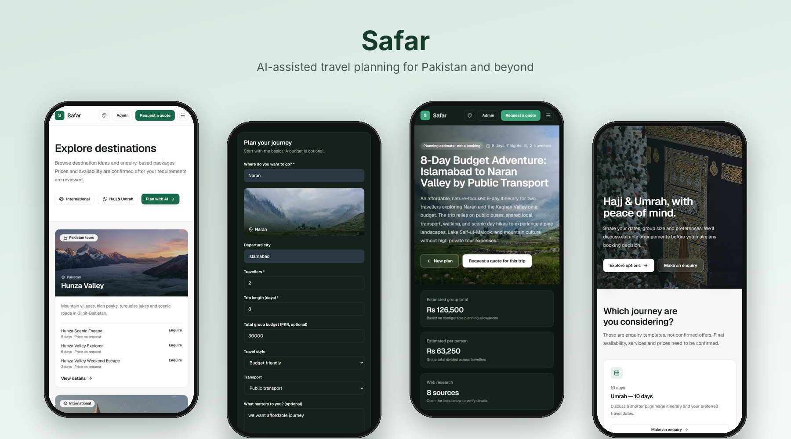
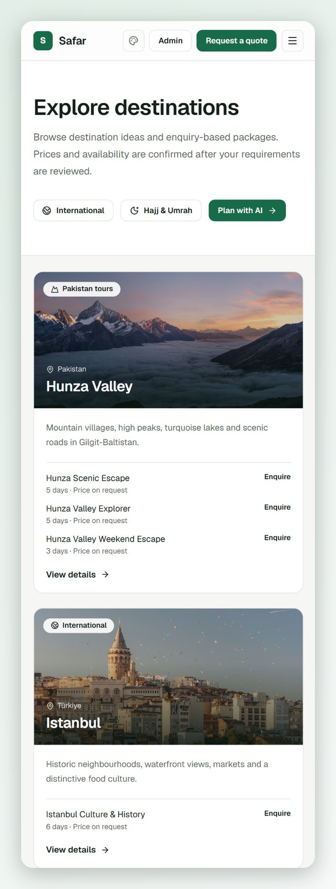
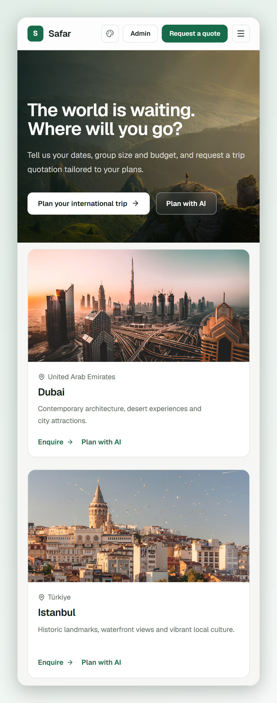
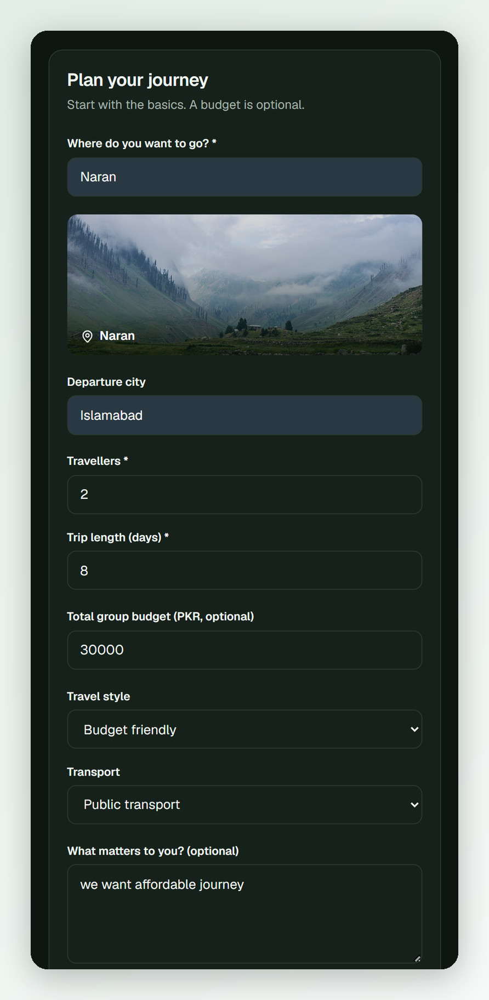
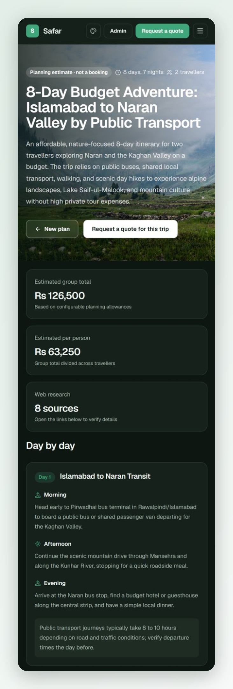
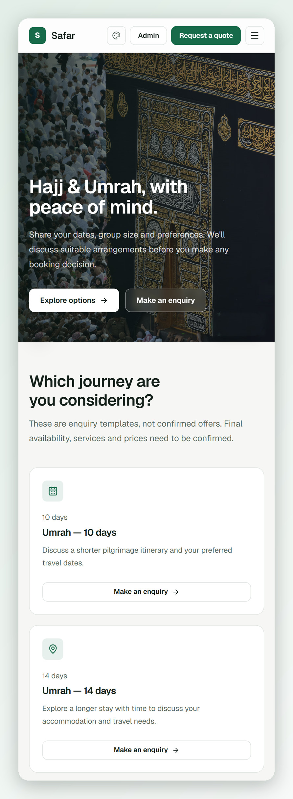
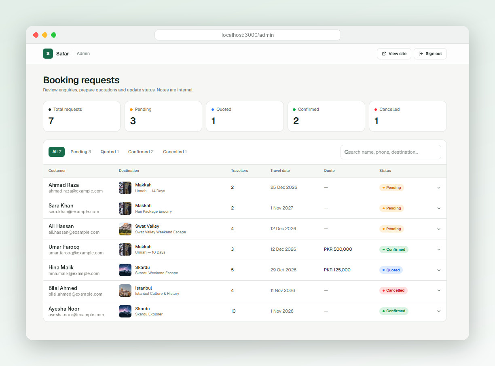

# Safar — AI-Assisted Travel Platform

Safar is a full-stack travel website for planning and booking trips across Pakistan and abroad. Visitors can browse destinations, generate an AI-written itinerary with a cost estimate, and send booking requests that an admin manages from a private dashboard.

[](https://github.com/UmarRao1/safar-travel-platform/actions/workflows/ci.yml)


## Screenshots



| Destinations | International |
|---|---|
|  |  |

| AI trip planner | Generated trip |
|---|---|
|  |  |

| Hajj & Umrah |
|---|
|  |

### Admin dashboard



> Customer names and emails in the admin screenshot are sample data.

## Features

- **Destination catalogue** — database-driven destinations and tour packages (domestic, international, Hajj & Umrah).
- **AI trip planner** — generates day-by-day itineraries with Google Gemini, enriched with web results from Tavily, plus an interactive Leaflet map.
- **Cost estimates** — configurable per-person planning allowances (accommodation, meals, transport, activities, contingency).
- **Booking requests** — customers submit enquiries; status flows `PENDING → QUOTED → CONFIRMED / CANCELLED`.
- **Admin dashboard** — password-protected area to review bookings, add quotes and notes.
- **Light/dark theme and accent colours.**

## Tech stack

| Area | Technology |
|---|---|
| Framework | Next.js (App Router), React, TypeScript |
| Styling | Tailwind CSS |
| Database | PostgreSQL with Prisma ORM |
| AI | Google Gemini (`@google/genai`), Tavily search |
| Auth (admin) | bcrypt password hash + signed session cookie |
| Validation | Zod |
| Maps / icons | Leaflet, lucide-react |

## Getting started

### Prerequisites
- Node.js 20 or newer
- A PostgreSQL database (local or hosted)
- Gemini and Tavily API keys (needed only for the AI planner)

### Setup

```bash
git clone https://github.com/UmarRao1/safar-travel-platform.git
cd YOUR_REPO
npm install

cp .env.example .env        # Windows PowerShell: Copy-Item .env.example .env
# edit .env and fill in your values (see table below)

npm run db:generate         # generate the Prisma client
npm run db:migrate          # create the database tables
npm run db:seed             # seed sample destinations
npm run db:seed:catalogue   # seed the extended catalogue and packages

npm run dev
```

Open http://localhost:3000.

### Admin account

```bash
npm run admin:hash          # prompts for a password and prints a bcrypt hash
```

Put the hash in `ADMIN_PASSWORD_HASH`, set `ADMIN_EMAIL` and a random `ADMIN_SESSION_SECRET` (32+ characters), restart the dev server, then sign in at `/admin/login`. Use `npm run admin:check` to verify the configuration.

## Environment variables

| Variable | Description |
|---|---|
| `DATABASE_URL` | PostgreSQL connection string |
| `GEMINI_API_KEY`, `GEMINI_MODEL` | Google Gemini key and model (default `gemini-2.5-flash`) |
| `TAVILY_API_KEY` | Tavily web search key |
| `ADMIN_EMAIL` | Admin login email |
| `ADMIN_PASSWORD_HASH` | bcrypt hash of the admin password |
| `ADMIN_SESSION_SECRET` | Secret used to sign admin sessions (32+ chars) |
| `SAFAR_RATE_*`, `SAFAR_CONTINGENCY_PERCENT` | Illustrative PKR allowances used for cost estimates |

Never commit your real `.env` file.

## Scripts

| Command | Purpose |
|---|---|
| `npm run dev` | Start the development server |
| `npm run build` / `npm start` | Production build / run |
| `npm run lint` | ESLint |
| `npm run typecheck` | TypeScript check |
| `npm run db:migrate` | Create/apply migrations in development |
| `npm run db:deploy` | Apply migrations in production |
| `npm run db:check` | Test the database connection |

## Project structure

```
app/            Pages and API routes (App Router)
  admin/        Admin login and bookings dashboard
  api/          bookings, admin auth, AI trip planner, place images
  destinations/ international/ hajj-umrah/ plan-trip/ booking/ trip-results/
components/     Shared UI, site shell and map components
lib/            Prisma client, geo helpers, admin session, place images
prisma/         Schema, migrations and seed scripts
scripts/        Admin and database helper scripts
```

## Deployment

Deploy to Vercel or any Node host. Set all environment variables, then run `npm run db:deploy` against your production database. The build script generates the Prisma client automatically.

## Disclaimer

Prices and cost estimates are illustrative planning figures, not live quotes. Always verify Hajj/Umrah and visa requirements with official sources.

## License

Released under the [MIT License](LICENSE).
